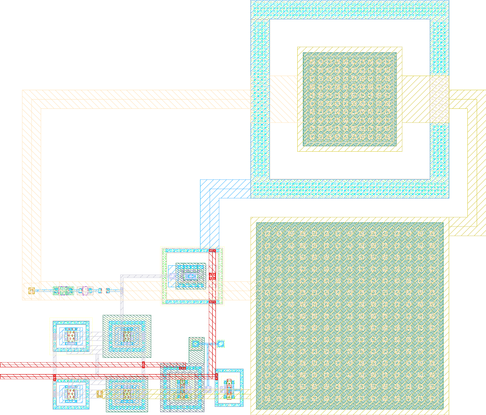
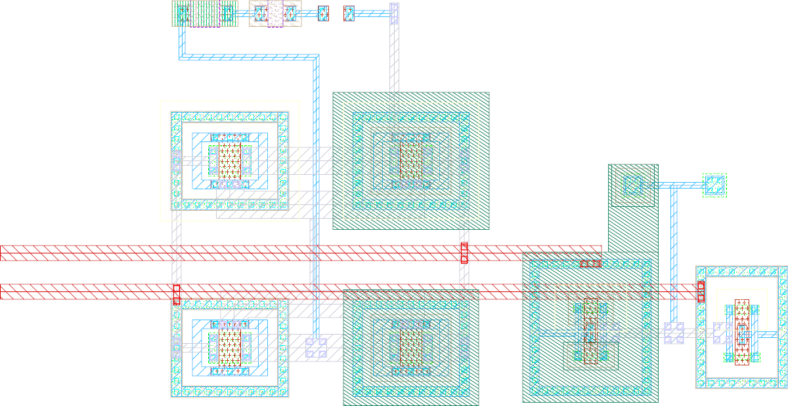
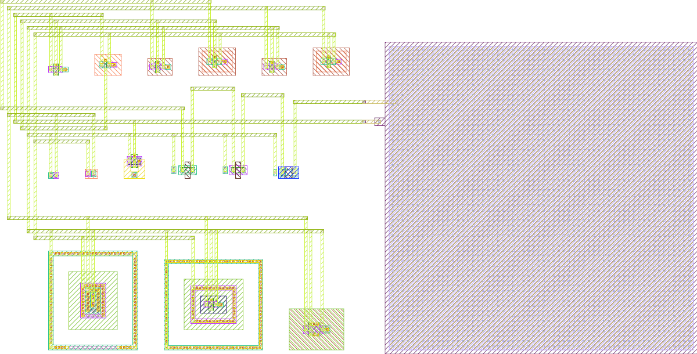
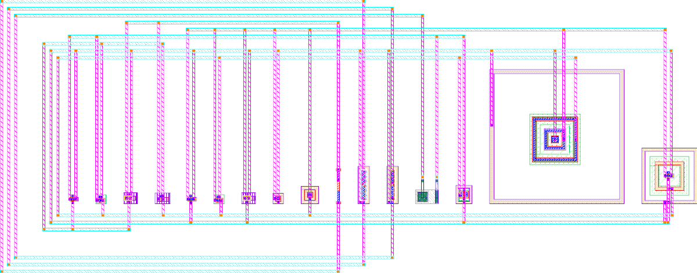
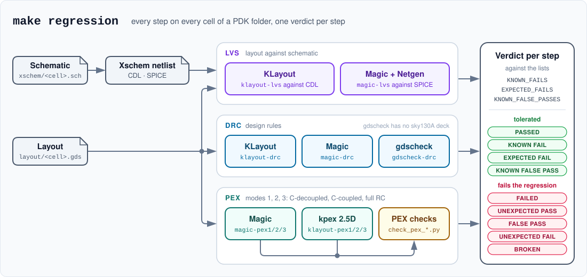

# DRC / LVS / PEX Regression Tests for Open-PDKs

[](LICENSE)
[](https://github.com/iic-jku/open-pdks-regression-tests/actions/workflows/regression-ihp-sg13g2.yml)
[](https://github.com/iic-jku/open-pdks-regression-tests/actions/workflows/regression-ihp-sg13cmos5l.yml)
[](https://github.com/iic-jku/open-pdks-regression-tests/actions/workflows/regression-gf180mcuD.yml)
[](https://github.com/iic-jku/open-pdks-regression-tests/actions/workflows/regression-sky130A.yml)
[](https://github.com/iic-jku/open-pdks-regression-tests/actions/workflows/license-check.yml)
[](https://doi.org/10.5281/zenodo.24500600)

(c) 2026 Julian Schwarz, Simon Dorrer, and Harald Pretl

Institute for Integrated Circuits and Quantum Computing, Johannes Kepler University (JKU), Linz, Austria

> [!IMPORTANT]
> This repository requires the [IIC-OSIC-TOOLS](https://github.com/iic-jku/IIC-OSIC-TOOLS) container with tag `2026.11` or later.

<table>
  <tr>
    <td align="center" width="50%">
      <picture>
        <source media="(prefers-color-scheme: dark)" srcset="doc/fig/render/ihp-sg13g2_combined_black.png">
        
      </picture>
      <br><em><code>ihp-sg13g2</code>: <code>sg13_combined</code></em>
    </td>
    <td align="center" width="50%">
      <picture>
        <source media="(prefers-color-scheme: dark)" srcset="doc/fig/render/ihp-sg13cmos5l_combined_black.png">
        
      </picture>
      <br><em><code>ihp-sg13cmos5l</code>: <code>sg13_combined</code></em>
    </td>
  </tr>
  <tr>
    <td align="center" width="50%">
      <picture>
        <source media="(prefers-color-scheme: dark)" srcset="doc/fig/render/gf180mcuD_combined_black.png">
        
      </picture>
      <br><em><code>gf180mcuD</code>: <code>gf180_combined</code></em>
    </td>
    <td align="center" width="50%">
      <picture>
        <source media="(prefers-color-scheme: dark)" srcset="doc/fig/render/sky130A_combined_black.png">
        
      </picture>
      <br><em><code>sky130A</code>: <code>sky130_combined</code></em>
    </td>
  </tr>
</table>
<p align="center">
  <em>The combined test cell of each PDK puts several of its device cells into one layout. Rendered with <code>sak-render.py</code>.</em>
</p>


## Overview

This repository holds DRC, LVS, and PEX regression tests for the open-source PDKs `ihp-sg13g2`, `ihp-sg13cmos5l`, `gf180mcuD`, and `sky130A`. Each PDK folder has one small cell per device, with a layout and a schematic (MOS transistors, resistors, capacitors, diodes, bipolar transistors), plus cells that are broken on purpose. One `make regression` runs all of them through KLayout DRC and LVS, Magic DRC, Magic + Netgen LVS, gdscheck DRC, and parasitic extraction with Magic and the kpex 2.5D engine.

What is tested are the tools and the PDK decks, not a design. When a new Magic, KLayout, Netgen, gdscheck, kpex, Xschem, or PDK version changes a verdict, the regression fails and names the cell and the step. A failure caused by a known tool or PDK bug is listed in the folder's `Makefile` and written up in its `KNOWN_ISSUES.md`. The regression accepts it while the bug exists and fails once the step passes, so no entry outlives its bug.

Next to the regression, each PDK has a PEX bench: metal-only dummy layouts whose parasitics follow from the extraction deck by hand. They are extracted with Magic and kpex, and the values are checked against the deck arithmetic and the committed expected results.

The [IIC-OSIC-TOOLS](https://github.com/iic-jku/IIC-OSIC-TOOLS) run parts of this repository with every nightly build and before every release ([test 26](https://github.com/iic-jku/IIC-OSIC-TOOLS/blob/next_release/_tests/26/test_drc_lvs_pex_sg13g2.sh), [test 31](https://github.com/iic-jku/IIC-OSIC-TOOLS/blob/next_release/_tests/31/test_drc_lvs_pex_sg13cmos5l.sh), [test 35](https://github.com/iic-jku/IIC-OSIC-TOOLS/blob/next_release/_tests/35/test_pex_bench.sh), [test 47](https://github.com/iic-jku/IIC-OSIC-TOOLS/blob/next_release/_tests/47/test_drc_lvs_pex_gf180mcud.sh), [test 48](https://github.com/iic-jku/IIC-OSIC-TOOLS/blob/next_release/_tests/48/test_drc_lvs_pex_sky130a.sh)), and the [CI](#continuous-integration) of this repository runs all four PDKs on every change of `main` on the IIC-OSIC-TOOLS nightly image.

<p align="center">
  
</p>


## PDKs

| PDK | Cells | PEX bench layouts | CI | IIC-OSIC-TOOLS test | Documentation |
| --- | :---: | :---: | --- | --- | --- |
| `ihp-sg13g2` | 42 | 63 | [](https://github.com/iic-jku/open-pdks-regression-tests/actions/workflows/regression-ihp-sg13g2.yml) | 26, 35 | [README](ihp-sg13g2/README.md), [known issues](ihp-sg13g2/KNOWN_ISSUES.md), [expected fails](ihp-sg13g2/EXPECTED_FAILS.md), [findings](ihp-sg13g2/FINDINGS.md), [PEX bench](ihp-sg13g2/pex_bench/README.md) |
| `ihp-sg13cmos5l` | 32 | 54 | [](https://github.com/iic-jku/open-pdks-regression-tests/actions/workflows/regression-ihp-sg13cmos5l.yml) | 31, 35 | [README](ihp-sg13cmos5l/README.md), [known issues](ihp-sg13cmos5l/KNOWN_ISSUES.md), [expected fails](ihp-sg13cmos5l/EXPECTED_FAILS.md), [findings](ihp-sg13cmos5l/FINDINGS.md), [PEX bench](ihp-sg13cmos5l/pex_bench/README.md) |
| `gf180mcuD` | 68 | 50 | [](https://github.com/iic-jku/open-pdks-regression-tests/actions/workflows/regression-gf180mcuD.yml) | 47, 35 | [README](gf180mcuD/README.md), [known issues](gf180mcuD/KNOWN_ISSUES.md), [expected fails](gf180mcuD/EXPECTED_FAILS.md), [findings](gf180mcuD/FINDINGS.md), [PEX bench](gf180mcuD/pex_bench/README.md) |
| `sky130A` | 79 | 58 | [](https://github.com/iic-jku/open-pdks-regression-tests/actions/workflows/regression-sky130A.yml) | 48, 35 | [README](sky130A/README.md), [known issues](sky130A/KNOWN_ISSUES.md), [expected fails](sky130A/EXPECTED_FAILS.md), [findings](sky130A/FINDINGS.md), [PEX bench](sky130A/pex_bench/README.md) |

The README of each folder documents every target, the regression rules, and the status of every cell. `KNOWN_ISSUES.md` explains the cause of each known failure and links the upstream issue where there is one, `EXPECTED_FAILS.md` describes what is broken in each cell that is broken on purpose, and `FINDINGS.md` collects the things in the PDK that are easy to get wrong when drawing these devices.


## Quick Start

Start the [IIC-OSIC-TOOLS](https://github.com/iic-jku/IIC-OSIC-TOOLS) container, then clone the repository and run a PDK folder with `make -C <pdk>`:

```sh
git clone https://github.com/iic-jku/open-pdks-regression-tests.git
cd open-pdks-regression-tests
make -C ihp-sg13g2 help                                # targets of one PDK folder
make -C ihp-sg13g2 regression                          # every cell through every step
make -C ihp-sg13g2 regression STEPS=%-lvs              # both LVS steps on every cell
make -C ihp-sg13g2 magic-lvs CELL=sg13_lv_nmos_tap     # one step on one cell
make -C ihp-sg13g2 pex-bench                           # the PEX bench, against the expected values
```

Each folder switches make to its own PDK with `sak-pdk-script.sh` (the PDK guard of `common.mk`), so the PDK selected in the container does not matter. Run make from inside the folder or with `-C <pdk>`. `make -f <pdk>/Makefile` does not work, because the relative paths would then resolve against the current directory. Generated netlists and reports land in `<pdk>/netlist/` and `<pdk>/verification/`, and `make -C <pdk> clean` removes them.


## Regression Steps

`make regression` runs these steps on every cell in `layout/`, in this order:

| Step | Tool | What it checks |
| --- | --- | --- |
| `klayout-drc` | KLayout (`sak-drc.sh -k`) | DRC at `DRC_LEVEL=macro` |
| `klayout-lvs` | KLayout (`sak-lvs.sh -k`) | LVS against the Xschem CDL netlist |
| `magic-drc` | Magic (`sak-drc.sh -m`) | DRC with the full rule set of the Magic tech file |
| `magic-lvs` | Magic + Netgen (`sak-lvs.sh`) | LVS against the Xschem SPICE netlist |
| `gdscheck-drc` | gdscheck (`sak-drc.sh -g`) | DRC with the `core` suite of its built-in rule decks (`ihp-sg13g2`, `ihp-sg13cmos5l`, `gf180mcuD`) |
| `magic-pex1`, `magic-pex2`, `magic-pex3` | Magic (`sak-pex.sh`) | C-decoupled, C-coupled, and full-RC extraction |
| `klayout-pex1`, `klayout-pex2`, `klayout-pex3` | kpex 2.5D engine (`sak-pex.sh -k`) | C-decoupled, C-coupled, and full-RC extraction |

After every extraction, [`scripts/check_pex_ports.py`](scripts/check_pex_ports.py) fails a netlist with a port that no element connects to. After a full-RC extraction, [`scripts/check_pex_modes.py`](scripts/check_pex_modes.py) compares the netlist with the C-coupled one of the same cell and fails it when a device terminal lost its port or two ports are joined through resistors. gdscheck 0.2.2 has no rule decks for `sky130A`, so that folder leaves `gdscheck-drc` out.


## Verdicts

Three lists in the `Makefile` of each folder say how a step is expected to end, one entry per `<cell>:<step>` or `<cell>` for all steps of a cell:

- `KNOWN_FAILS`: steps that should pass but fail because of a tool or PDK bug.
- `EXPECTED_FAILS`: DRC and LVS steps of cells broken on purpose, which the tool has to catch.
- `KNOWN_FALSE_PASSES`: DRC and LVS steps of cells broken on purpose, which the tool misses because of a bug.

Each step then gets one of these outcomes. The outcomes in bold fail the regression:

| Listed in | Step passes | Step fails with a finding | Step fails without a finding |
| --- | --- | --- | --- |
| (none) | PASSED | **FAILED** | **FAILED** |
| `KNOWN_FAILS` | **UNEXPECTED PASS** | KNOWN FAIL | KNOWN FAIL |
| `EXPECTED_FAILS` | **FALSE PASS** | EXPECTED FAIL | **BROKEN** |
| `KNOWN_FALSE_PASSES` | KNOWN FALSE PASS | **UNEXPECTED FAIL** | **BROKEN** |

A finding means DRC violations or a layout that does not match its schematic, read from the exit code of `sak-drc.sh` or `sak-lvs.sh`. A step that fails without a finding never reached the check, so it says nothing about the cell. An UNEXPECTED PASS or UNEXPECTED FAIL means a bug was fixed, and the entry has to be removed or moved. `make regression` exits with a non-zero status on any bold outcome, so it works directly as a CI gate, and it ends with summary lines like these:

```
[REGRESSION] SUMMARY: KNOWN FAIL cells (tool bug, ignored): sg13_cmomi(magic-lvs)
[REGRESSION] SUMMARY: No unexpected failures
```

The rules in full, including whole-cell entries, are in the README of each folder.


## PEX Bench

The PEX bench of each PDK in `<pdk>/pex_bench/` checks the extracted values, which the regression does not. Its layouts are generated by the scripts in `pex_bench/scripts/`, for example plates, wires, plates over plates, wires at swept spacing, wires with two ports, via chains, a tee, a cross, and an inverter with a long gate wire. Their parasitics follow from the extraction deck by hand. `make pex-bench` extracts them with Magic in all three modes and with the kpex 2.5D engine, compares the numbers with the deck arithmetic, and checks them against `pex_bench/expected/results.json`. `make pex-bench FASTERCAP=1` adds a FasterCap field solve.

[ihp-sg13g2/pex_bench/README.md](ihp-sg13g2/pex_bench/README.md) describes how the bench was built, and [ihp-sg13g2/pex_bench/report/pex_bench_report.html](ihp-sg13g2/pex_bench/report/pex_bench_report.html) what it found in Magic and kpex.


## Upstream Reports

Issues filed while building these tests:

| Project | Issues |
| --- | --- |
| [Magic](https://github.com/RTimothyEdwards/magic) | [#532](https://github.com/RTimothyEdwards/magic/issues/532) full-RC crash on an `ihp-sg13g2` layout, [#552](https://github.com/RTimothyEdwards/magic/issues/552) LVS and PEX of the IHP MOM capacitors, [#557](https://github.com/RTimothyEdwards/magic/issues/557) five parasitic extraction defects on `ihp-sg13g2`, with the PEX bench as the reproducer |
| [kpex](https://github.com/iic-jku/kpex) | [#156](https://github.com/iic-jku/kpex/issues/156) and [#197](https://github.com/iic-jku/kpex/issues/197) capacitance test patterns for `gf180mcuD` and `ihp-sg13g2`, [#198](https://github.com/iic-jku/kpex/issues/198) `--mesh` ignored and duplicated resistors in RC mode, [#587](https://github.com/iic-jku/kpex/issues/587) a `sky130A` varactor in a child cell, [#588](https://github.com/iic-jku/kpex/issues/588) the `sky130A` 11 V NPN on KLayout 0.30, [#589](https://github.com/iic-jku/kpex/issues/589) cells with a device that has no model, [#590](https://github.com/iic-jku/kpex/issues/590) the `gf180mcuD` Schottky diode in RC mode |
| [gdscheck](https://github.com/aesc-silicon/gdscheck) | [#63](https://github.com/aesc-silicon/gdscheck/issues/63) `V1.b1` to `V4.b1` on the IHP MOM capacitor, [#64](https://github.com/aesc-silicon/gdscheck/issues/64) `PP.6` and `NP.6` on the butted taps of `gf180mcuD`, [#65](https://github.com/aesc-silicon/gdscheck/issues/65) `MIMTM.10` missed outside the MIM top plate |
| [Xschem](https://github.com/StefanSchippers/xschem) | [#465](https://github.com/StefanSchippers/xschem/issues/465) rounding precision of device properties in LVS netlists |

The `KNOWN_ISSUES.md` of each PDK links the further upstream issues and pull requests that its known failures depend on, in Magic, open_pdks, the gf180mcu libraries, and the IHP Open PDK.


## Continuous Integration

| Workflow | Trigger | What it runs |
| --- | --- | --- |
| [`regression-ihp-sg13g2.yml`](.github/workflows/regression-ihp-sg13g2.yml), [`regression-ihp-sg13cmos5l.yml`](.github/workflows/regression-ihp-sg13cmos5l.yml), [`regression-gf180mcuD.yml`](.github/workflows/regression-gf180mcuD.yml), [`regression-sky130A.yml`](.github/workflows/regression-sky130A.yml) | Push and pull request to `main` (documentation-only changes excepted), and manual dispatch | `make regression`, then `make pex-bench`, of one PDK in the IIC-OSIC-TOOLS container |
| [`license-check.yml`](.github/workflows/license-check.yml) | Push and pull request to `main` | `reuse lint` |

The four regression workflows share the job in [`regression-common.yml`](.github/workflows/regression-common.yml). They test `ghcr.io/iic-jku/iic-osic-tools:nightly`, the image of the last night. There is no schedule, because the IIC-OSIC-TOOLS run the `main` branch of this repository against every new nightly image themselves (tests 26, 31, 35, 47, and 48), so the workflows here check the changes made here. A manual dispatch takes any other image, for example a release tag like `hpretl/iic-osic-tools:2026.11`. The job summary lists the tool versions of the image and the summary lines of both runs, which also appear as annotations on the run page. The logs, reports, and netlists are kept as an artifact for 30 days.


## Directory Structure

<details>
<summary>Click to expand</summary>

```
.
├── common.mk                  # every target, included by the Makefile of each PDK folder
├── scripts/                   # PEX port and mode checks, FasterCap reference helper
├── ihp-sg13g2/                # one folder per PDK, all four with the same structure
│   ├── Makefile               # REQUIRED_PDK, KNOWN_FAILS, EXPECTED_FAILS, KNOWN_FALSE_PASSES
│   ├── README.md              # targets, regression rules, status of every cell
│   ├── KNOWN_ISSUES.md        # why each KNOWN_FAILS and KNOWN_FALSE_PASSES entry is there
│   ├── EXPECTED_FAILS.md      # what is broken in each cell broken on purpose
│   ├── FINDINGS.md            # PDK pitfalls found while drawing the cells
│   ├── layout/                # one GDS per cell
│   ├── schematic/xschem/      # one schematic per cell, xschemrc
│   ├── netlist/               # generated netlists (git-ignored)
│   ├── verification/          # generated DRC and LVS reports (git-ignored)
│   └── pex_bench/             # PEX bench: Makefile, generators, layouts, expected results
├── ihp-sg13cmos5l/
├── gf180mcuD/
├── sky130A/
├── doc/fig/                   # README figures
├── .github/workflows/         # regression per PDK, license check
├── CITATION.cff
├── LICENSE
└── REUSE.toml
```

</details>


## Adding a Cell

1. Draw `layout/<cell>.gds` and `schematic/xschem/<cell>.sch` with the same name in the PDK folder. The regression picks up every GDS in `layout/`.
2. Run `make regression LAYOUT_CELLS=<cell>`.
3. A step that fails because of a tool or PDK bug goes into `KNOWN_FAILS` with a section in `KNOWN_ISSUES.md`. A cell broken on purpose goes into `EXPECTED_FAILS` with a section in `EXPECTED_FAILS.md`.
4. Add the cell to "Supported Cells" in the README of the folder, and update the cell count in the table above.


## Cite This Work

```
@misc{2026_open_pdks_regression_tests,
  author = {Schwarz, Julian and Dorrer, Simon and Pretl, Harald},
  month = nov,
  year = {2026},
  title = {{GitHub Repository of DRC / LVS / PEX Regression Tests for Open-PDKs}},
  url = {https://github.com/iic-jku/open-pdks-regression-tests},
  doi = {10.5281/zenodo.24500600}
}
```


## Acknowledgements

This project is funded by the JKU/SAL [IWS Lab](https://research.jku.at/de/projects/jku-lit-sal-intelligent-wireless-systems-lab-iws-lab/), a collaboration of [Johannes Kepler University](https://jku.at) and [Silicon Austria Labs](https://silicon-austria-labs.com).

<table width="100%">
  <tr>
    <td align="left" width="50%">
      <a href="https://iic.jku.at" target="_blank">
        
      </a>
    </td>
    <td align="right" width="50%">
      <a href="https://silicon-austria-labs.com" target="_blank">
        
      </a>
    </td>
  </tr>
</table>


## License

Licensed under the **Apache License 2.0**, see [`LICENSE`](LICENSE).
